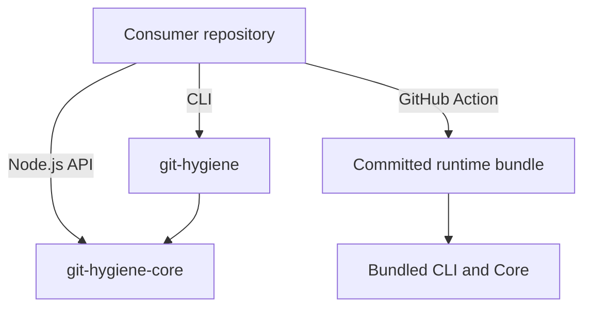

<div align="center">
  

  <h1>git-hygiene 🌊</h1>
  <p>Validate commits, branch names, and pull request titles with shared rules.</p>

  <p>
  <a href="https://github.com/chitranklabs/git-hygiene/actions/workflows/ci.yml">
    
  </a>
  <a href="https://github.com/chitranklabs/git-hygiene/actions/workflows/scorecard.yml">
    
  </a>
  <a href="https://scorecard.dev/viewer/?uri=github.com/chitranklabs/git-hygiene">
    
  </a>
  <a href="https://github.com/gitleaks/gitleaks">
    
  </a>
  <a href="https://github.com/woodruffw/zizmor">
    
  </a>
  <a href="https://codecov.io/gh/chitranklabs/git-hygiene">
    
  </a>
  <a href="https://github.com/chitranklabs/git-hygiene/attestations">
    
  </a>
  <a href="./LICENSE">
    
  </a>
  <br/>
  <br/>
    <a href="https://ko-fi.com/D1D71U581P" target="_blank">
      
    </a>
  <br/>

[Features](#features) • [Installation](#installation) • [Usage](#usage) • [Architecture](#architecture) • [Contributing](#contributing)

  <br/>
</div>

`git-hygiene` checks Git metadata and recommends semantic version changes. Use the
CLI in hooks, the bundled GitHub Action in CI, or the Core API inside your own
Node.js tooling. They share the same configuration format.

## Why git-hygiene

Keep commit, branch and PR title conventions in one `package.json` configuration.
Local hooks give fast feedback; CI provides checks that do not depend on each
contributor installing those hooks. Validation and release recommendations remain
separate from publishing.

## Workspace guide

| Location                       | Purpose                                       | Start here                                                                           |
| ------------------------------ | --------------------------------------------- | ------------------------------------------------------------------------------------ |
| `packages/cli`                 | Published command-line tool                   | [CLI package](packages/cli/README.md)                                                |
| `packages/core`                | Published Node.js validation engine           | [Core package](packages/core/README.md)                                              |
| `action.yml`, `dist/action.js` | Composite action and committed runtime bundle | [Action guide](https://docs.githygiene.chitrankagnihotri.com/guides/github-actions/) |
| `app`                          | Private Next.js website and sandbox           | [Website development](app/README.md)                                                 |
| `docs`                         | Independent Monoline Docs handbook            | [Documentation](https://docs.githygiene.chitrankagnihotri.com/)                      |

## Features <a id="features"></a>

<a id="features--"></a>

- Validate commits with commitlint rules derived from your configuration.
- Check branch names and PR title format; title checks do not run every commit rule.
- Read JSON output for automation or embed the asynchronous Core API.
- Recommend a semantic release type from Git history without publishing anything.

## Installation <a id="installation"></a>

<a id="installation--"></a>

Use Node.js 24 or newer. Install the CLI in the repository you want to check:

```bash
npm install --save-dev @chitrank2050/git-hygiene
```

For pnpm, use `pnpm add -D @chitrank2050/git-hygiene`. Keep the dependency in your
lockfile so contributors and CI use the same version.

## Usage <a id="usage"></a>

<a id="5-programmatic-usage-library"></a>

<a id="4-manual--script-usage"></a>

<a id="2-local-hooks-husky"></a>

<a id="1-local-hooks-lefthook"></a>

<a id="documentation"></a>

<a id="usage--️"></a>

Run from the directory containing the intended `package.json`:

```bash
npx --no-install git-hygiene commit "feat: add search"
npx --no-install git-hygiene branch "feat/add-search"
npx --no-install git-hygiene title "feat(search): add filters"
```

Valid input exits with status `0`; invalid input or an error exits with status `1`.
With default settings, `commit "added search"` fails and reports the violated rules.
See the [Quickstart](https://docs.githygiene.chitrankagnihotri.com/getting-started/)
for configuration and the first failure check.

| Goal                                                        | Guide                                                                                  |
| ----------------------------------------------------------- | -------------------------------------------------------------------------------------- |
| Check messages before committing or branches before pushing | [Lefthook and Husky](https://docs.githygiene.chitrankagnihotri.com/guides/git-hooks/)  |
| Validate metadata in CI                                     | [GitHub Actions](https://docs.githygiene.chitrankagnihotri.com/guides/github-actions/) |
| Run individual commands, use JSON or inspect exit status    | [Commands](https://docs.githygiene.chitrankagnihotri.com/reference/cli/)               |
| Embed validation in a Node.js tool                          | [Core API](https://docs.githygiene.chitrankagnihotri.com/reference/core-api/)          |

## GitHub Action

<a id="action-outputs-"></a>

<a id="usage-example"></a>

<a id="manual-mode"></a>

<a id="smart-zero-config-mode-recommended"></a>

<a id="3-github-actions-ci-"></a>

<a id="-github-action"></a>

The action runs a committed JavaScript bundle. It does not install the CLI from
npm during a run. Use the complete [workflow example and input/output reference](https://docs.githygiene.chitrankagnihotri.com/guides/github-actions/)
for checkout, Node setup, immutable action pins and permissions.

Explicit `title` mode checks the supplied title only. Default `omni` mode checks
available PR metadata and recommends a bump from Git history. Neither mode creates
a release. Review the revision you pin; older action revisions used a different
installation path.

## Configuration <a id="configuration"></a>

<a id="raw-commitlint-rules-️"></a>

<a id="extending-configurations-"></a>

<a id="example-packagejson"></a>

<a id="reference-table"></a>

<a id="configuration--️"></a>

Add a `git-hygiene` property to your existing `package.json`, retaining its other fields:

```json
{
  "git-hygiene": {
    "types": ["feat", "fix", "docs", "chore"],
    "ignoreBranches": ["main", "develop"],
    "maxHeaderLength": 100
  }
}
```

The loader reads the current directory, not parent directories. Ignored branches
are exact names, not globs. A conventional preset imports selected settings;
it does not merge every commitlint rule. See [configuration defaults and overrides](https://docs.githygiene.chitrankagnihotri.com/reference/configuration/)
before adapting an existing policy.

## Technical Specification

- CLI/Core require Node.js 24+; history-based operations also require Git and tags.
- npm packages expose ESM JavaScript; Core includes TypeScript declarations.
- CLI and Core have runtime dependencies. The bundled Action avoids an install
  step; that does not make the packages dependency-free.
- npm and JSR publish CLI/Core distributions. See each package README for its
  entry point; the Action is distributed from the repository separately.

## Registries & Links

<a id="-registries--links"></a>

| Distribution | npm                                                                              | JSR                                                               |
| ------------ | -------------------------------------------------------------------------------- | ----------------------------------------------------------------- |
| CLI          | [git-hygiene](https://www.npmjs.com/package/@chitrank2050/git-hygiene)           | [git-hygiene](https://jsr.io/@chitrank2050/git-hygiene)           |
| Core         | [git-hygiene-core](https://www.npmjs.com/package/@chitrank2050/git-hygiene-core) | [git-hygiene-core](https://jsr.io/@chitrank2050/git-hygiene-core) |

[GitHub Marketplace](https://github.com/marketplace/actions/git-hygiene-validator) ·
[Website](https://githygiene.chitrankagnihotri.com/) ·
[Documentation](https://docs.githygiene.chitrankagnihotri.com/) ·
[Release history](https://github.com/chitranklabs/git-hygiene/releases)

## Architecture <a id="architecture"></a>

<a id="architecture--️"></a>



See [development](https://docs.githygiene.chitrankagnihotri.com/development/)
for workspace ownership, verification and action bundle maintenance.

## Automated Releases

<a id="-automated-releases"></a>

`bump` recommends `patch`, `minor` or `major`, not a complete version number. No
qualifying history may produce no `releaseType`. It does not edit package versions,
tag Git history or publish packages.

This repository versions CLI and Core together with Changesets; the private app
is excluded. git-cliff supplies repository/website history separately. Follow
[CONTRIBUTING.md](https://github.com/chitranklabs/git-hygiene/blob/main/CONTRIBUTING.md)
for release preparation and publication.

## Contributing <a id="contributing"></a>

<a id="️-security--quality"></a>

<a id="contributing--"></a>

Start with the [contributor guide](https://github.com/chitranklabs/git-hygiene/blob/main/CONTRIBUTING.md).
Repository checks include tests, Gitleaks and Zizmor; attestations are linked above.
These checks do not guarantee vulnerability-free software.

<a id="community--support-"></a>
<a id="-security--quality"></a>

Use [issues](https://github.com/chitranklabs/git-hygiene/issues) for reproducible
bugs, follow the [Code of Conduct](https://github.com/chitranklabs/git-hygiene/blob/main/CODE_OF_CONDUCT.md),
and report vulnerabilities through [SECURITY.md](https://github.com/chitranklabs/git-hygiene/blob/main/SECURITY.md).

## Credits

<a id="-credits"></a>

Commit validation uses [commitlint](https://commitlint.js.org/).
Licensed under [MIT](https://github.com/chitranklabs/git-hygiene/blob/main/LICENSE).

<p align="center">❤️ Developed by <a href="https://chitrankagnihotri.com">Chitrank Agnihotri</a></p>
